<a id="top"></a>

<p align="center">
  
</p>

<p align="center">
  
</p>

<p align="center">
  <b>Structure prediction, protein design, RNA folding, cell simulation and cancer data, in one Mac app.</b><br>
  <sub>Light work runs on your Mac. Heavy models run on your own Modal account. Every result can be reopened and checked.</sub>
</p>

<p align="center">
  
  
  
  
  
  
</p>

<p align="center">
  <a href="https://github.com/sparklesviii23/fold-studio/releases/latest"></a>
  &nbsp;
  <a href="#build-from-source"></a>
</p>

<p align="center">
  <a href="#about">About</a>
  &nbsp;·&nbsp; <a href="#highlights">Highlights</a>
  &nbsp;·&nbsp; <a href="#gallery">Gallery</a>
  &nbsp;·&nbsp; <a href="#whats-inside">Features</a>
  &nbsp;·&nbsp; <a href="#how-it-works">How it works</a>
  &nbsp;·&nbsp; <a href="#getting-started">Getting started</a>
  &nbsp;·&nbsp; <a href="#current-limitations">Limitations</a>
  &nbsp;·&nbsp; <a href="#technology-and-credits">Credits</a>
  &nbsp;·&nbsp; <a href="#licence">Licence</a>
</p>

<br>

<p align="center">
  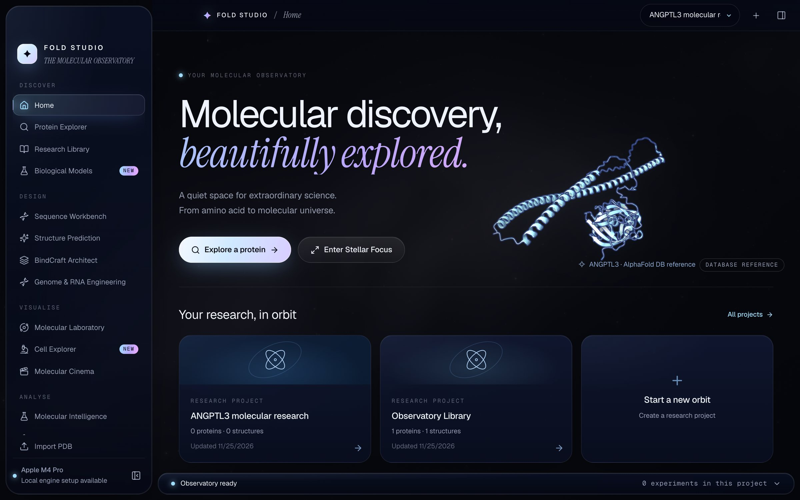
</p>

<p align="center">
  
</p>

> [!TIP]
> **Quick start.** Download the app from the [releases page](https://github.com/sparklesviii23/fold-studio/releases/latest) ([install steps](#download-the-app)), or [build it from source](#build-from-source).

## About

FOLD STUDIO puts structure prediction, protein design, RNA folding, cell
simulation and cancer data analysis in one desktop app. Light work runs on your
Mac. Heavy models run in containers on your own [Modal](https://modal.com)
account, and the results come back into the same research library.

Every result keeps its inputs, model version, logs and checksums, so you can
reopen it and see how it was made. Every screen says what kind of evidence it
shows: a measurement, a model prediction, a simulation or an illustration.
Results are computational predictions, not experimental findings.

Version 4.3.0 · macOS on Apple Silicon · app code under the MIT licence.

<p align="center"></p>

## Highlights

<table>
<tr>
<td width="33%" valign="top">
<h3>🧬 Protein design</h3>
The original BindCraft2 pipeline (AlphaFold2 design, ProteinMPNN, refolding, filters) runs on Apple Silicon through JAX on Metal. No NVIDIA GPU needed.
</td>
<td width="33%" valign="top">
<h3>🔬 A real cell</h3>
Open a HeLa cell imaged by electron microscopy, release molecules into it, and watch them diffuse and bind, with live readouts.
</td>
<td width="33%" valign="top">
<h3>🧫 Virtual cells</h3>
Build a K-562 cell from public Perturb-seq and DepMap data. Switch genes on or off, add drugs, branch and compare.
</td>
</tr>
<tr>
<td width="33%" valign="top">
<h3>☁️ Your own cloud</h3>
Boltz-2, RhoFold+, ESMFold2, Evo 2 and Borzoi run on your Modal account. You approve each run; files, logs and checksums come back.
</td>
<td width="33%" valign="top">
<h3>🌀 RNA end to end</h3>
Folding ensembles, exact folding kinetics, inverse design, and 3D prediction checked against crystal structures.
</td>
<td width="33%" valign="top">
<h3>📊 Cancer data</h3>
DepMap dependencies, GDSC drug response and TCGA cohorts in one workspace, next to tumour simulations.
</td>
</tr>
</table>

> [!NOTE]
> FOLD STUDIO is research software. Every screen labels its evidence as measured, predicted, simulated or illustrative, and nothing here is clinical advice.

<p align="right"><sub><a href="#top">Back to top ↑</a></sub></p>

<p align="center"></p>

## Gallery

Every picture comes from the current app. The experiments were run to make
them: local ones on an M4 Pro, cloud ones on Modal.

### Proteins and structure

<table>
<tr>
<td width="50%">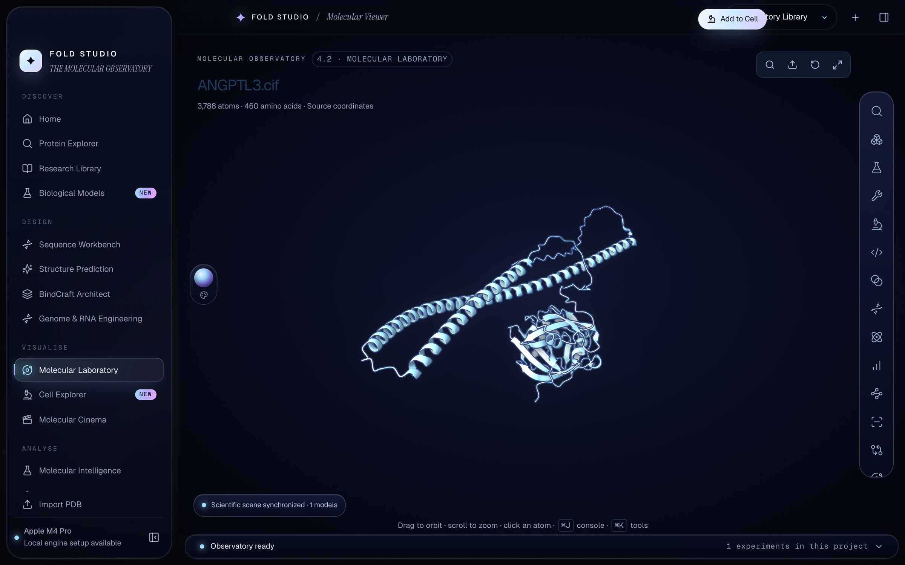<br><sub><b>Molecular Viewer.</b> ANGPTL3 from AlphaFold DB, drawn with Mol*.</sub></td>
<td width="50%">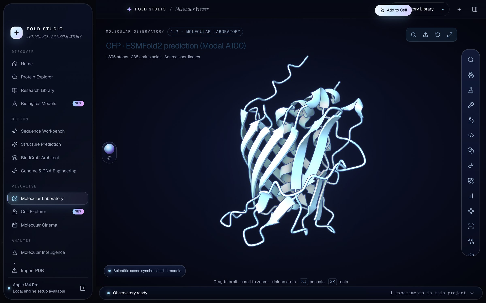<br><sub><b>ESMFold2 on Modal (A100).</b> Green fluorescent protein predicted from sequence; the barrel fold comes out.</sub></td>
</tr>
<tr>
<td width="50%">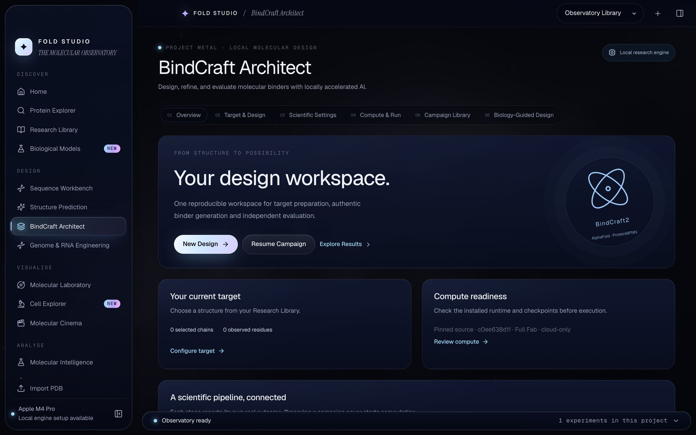<br><sub><b>BindCraft Architect.</b> Binder design campaigns that run locally on Apple Silicon.</sub></td>
<td width="50%"><br><sub><b>Protein Explorer.</b> UniProt sequences, annotations and known structures.</sub></td>
</tr>
</table>

### Cells

<table>
<tr>
<td width="50%">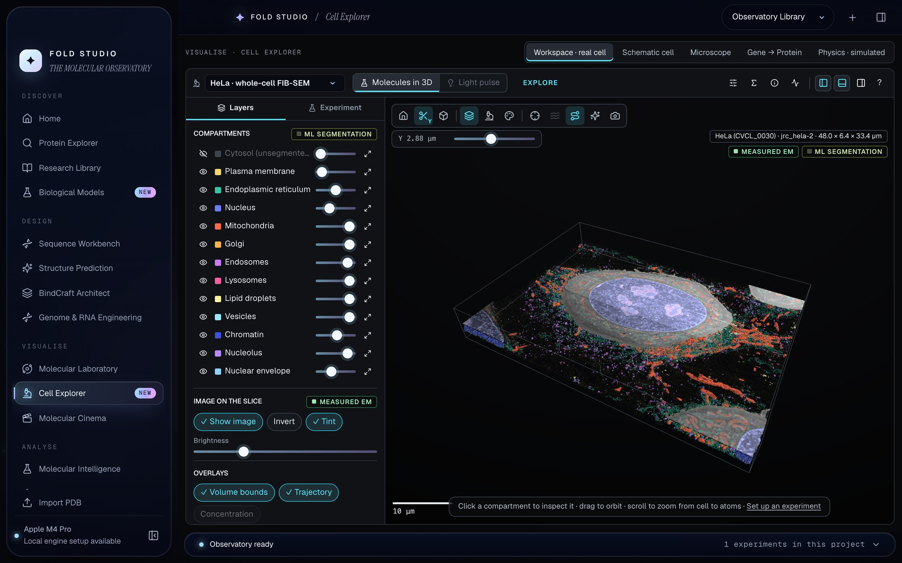<br><sub><b>Cell Explorer.</b> A whole HeLa cell imaged by FIB-SEM (OpenOrganelle <code>jrc_hela-2</code>), with machine-learning organelle segmentation.</sub></td>
<td width="50%">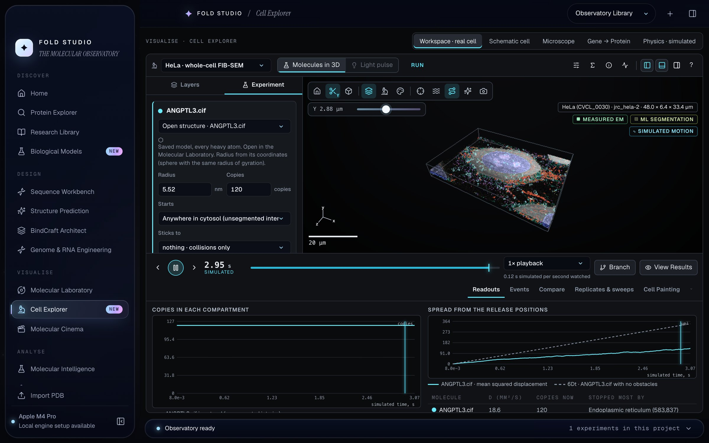<br><sub><b>An experiment inside it.</b> 120 copies of a protein released into the cytoplasm, moving by Brownian dynamics, with live counts per compartment.</sub></td>
</tr>
<tr>
<td width="50%">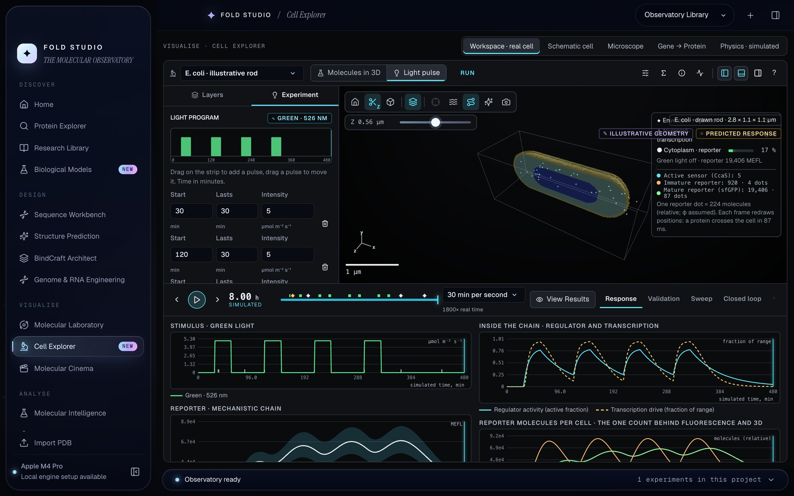<br><sub><b>Light pulse.</b> Green-light pulses drive a CcaS/CcaR reporter in E. coli; the fitted chain predicts the response.</sub></td>
<td width="50%">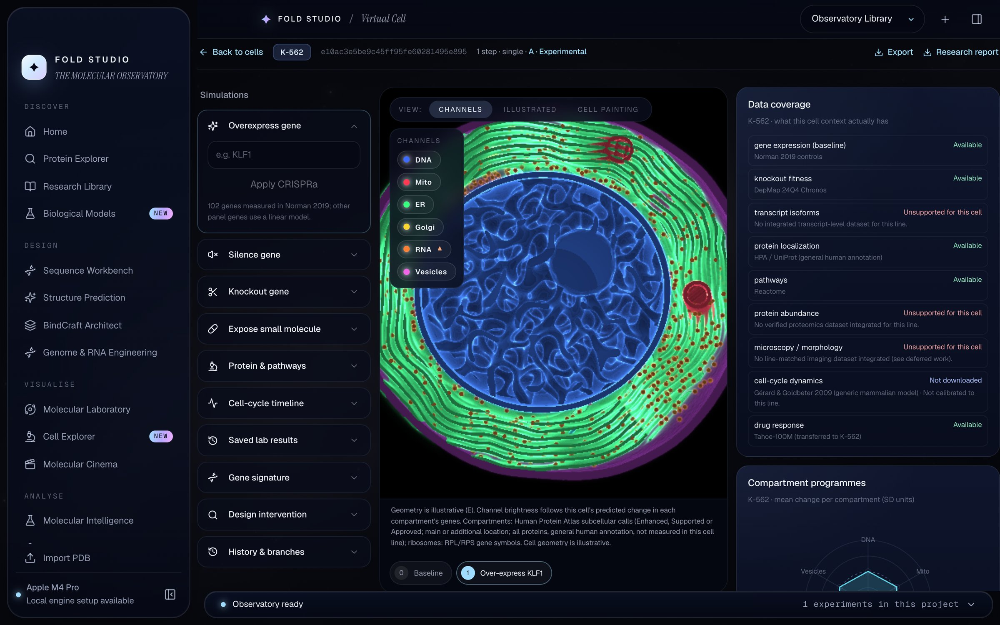<br><sub><b>Virtual Cell.</b> A K-562 cell built from Norman 2019, Replogle 2022 and DepMap, with KLF1 switched on by CRISPRa.</sub></td>
</tr>
</table>

### RNA

<table>
<tr>
<td width="50%"><br><sub><b>RhoFold+ on Modal (A10G).</b> Yeast tRNA-Phe predicted from sequence: the L shape is there.</sub></td>
<td width="50%"><br><sub><b>Checked against the crystal.</b> 1.83 Å C1′ RMSD to 1EHZ, all base pairs correct, no clashes.</sub></td>
</tr>
<tr>
<td width="50%"><br><sub><b>Folding ensemble.</b> 1,000 ViennaRNA samples of tRNA-Phe, grouped into distinct states with a base-pair probability dot plot.</sub></td>
<td width="50%"><br><sub><b>Folding kinetics.</b> Every secondary structure enumerated and the master equation solved exactly, no sampling.</sub></td>
</tr>
<tr>
<td width="50%"><br><sub><b>Inverse design on Modal CPU.</b> Sequences that fold into a branched target, each checked by a second model.</sub></td>
<td width="50%"><br><sub><b>Boltz-2 on Modal (A10G).</b> Five independent diffusion samples of the same tRNA.</sub></td>
</tr>
</table>

### Genomes, cancer and mechanisms

<table>
<tr>
<td width="50%">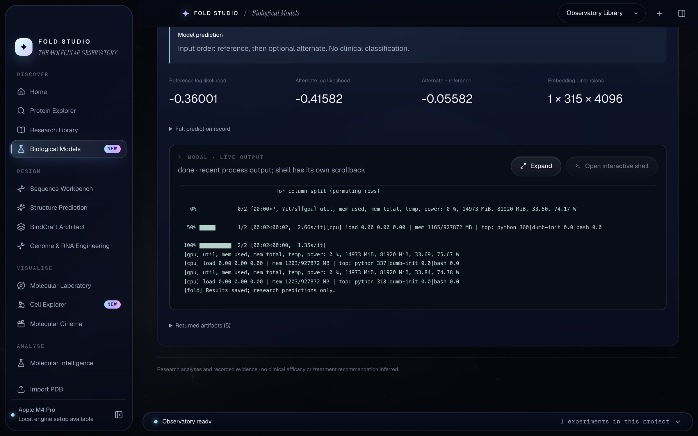<br><sub><b>Evo 2 on Modal (A100).</b> Likelihood of the normal HBB sequence against the sickle-cell variant, plus DNA embeddings.</sub></td>
<td width="50%"><br><sub><b>Borzoi on Modal (A100).</b> A predicted CAGE expression track across a 524 kb window at the HBB locus.</sub></td>
</tr>
<tr>
<td width="50%">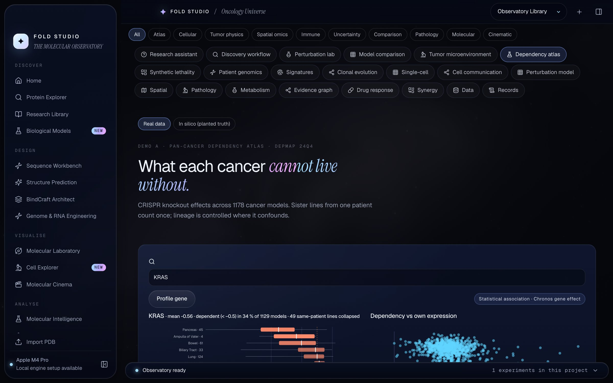<br><sub><b>Oncology Universe.</b> DepMap CRISPR knockouts across 1,178 cancer cell lines: which genes each cancer cannot live without.</sub></td>
<td width="50%"><br><sub><b>Tumour microenvironment.</b> PhysiCell agent-based tumour–immune models, run on your server.</sub></td>
</tr>
<tr>
<td width="50%">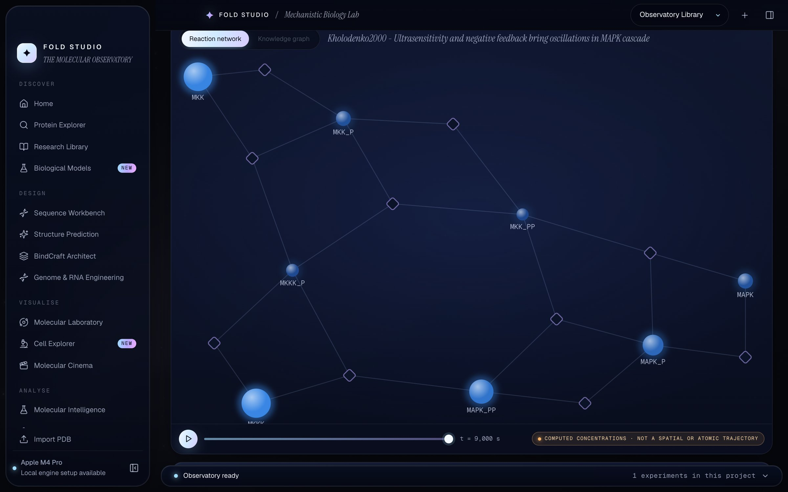<br><sub><b>Mechanistic Biology Lab.</b> The Kholodenko 2000 MAPK cascade integrated with SciPy, drawn as a reaction network.</sub></td>
<td width="50%">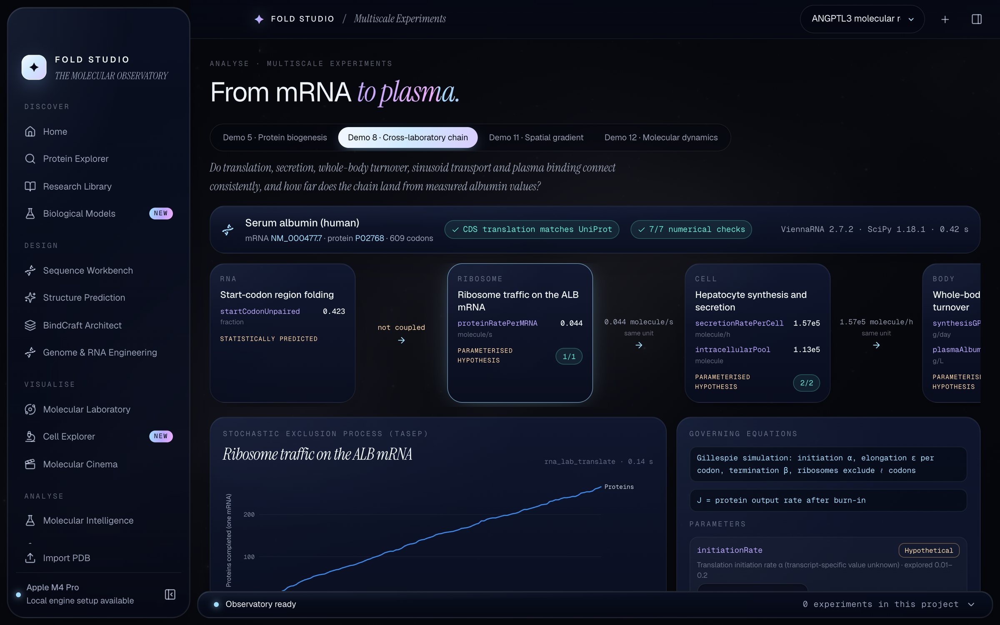<br><sub><b>Multiscale experiments.</b> One-way coupling from ribosome traffic on an mRNA to protein levels in plasma.</sub></td>
</tr>
</table>

### Compute

<table>
<tr>
<td width="50%"><br><sub><b>Cloud GPU Tasks.</b> Ready-made recipes that run in containers on your Modal account.</sub></td>
<td width="50%">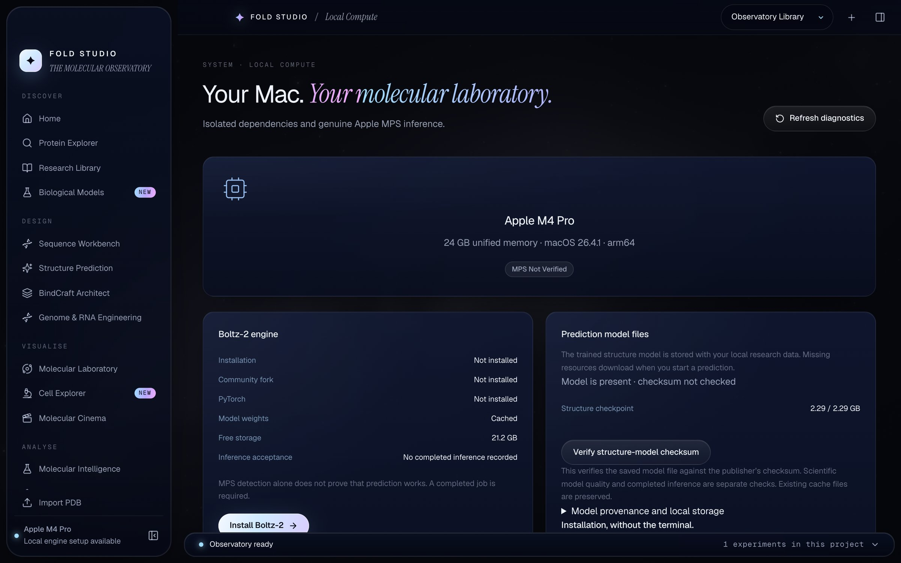<br><sub><b>Local Compute.</b> What this Mac can run, and which model files are present and verified.</sub></td>
</tr>
</table>

<p align="right"><sub><a href="#top">Back to top ↑</a></sub></p>

<p align="center"></p>

## What's inside

The app is organised into **Research**, **Design**, **Analyse** and
**Visualise**. Each entry links to its detailed document. Click a group to expand it.

<details open>
<summary><b>🧬 Proteins</b></summary>

| Feature | What it does |
| --- | --- |
| **Structure viewer and library** | Import PDB and mmCIF files; view atoms, cartoons and surfaces with Mol*; keep projects, names and notes in a persistent library. |
| **BindCraft2 binder design** | The original pipeline on Apple Silicon: AlphaFold2 design → ProteinMPNN → independent AlphaFold2 refolding → the original filters and ranking. Campaigns can be paused, resumed, reranked and exported. |
| **Boltz-2 prediction** | Structure and binding-affinity prediction on the Mac GPU (PyTorch/MPS), or on Modal. |
| [**Molecular Intelligence**](docs/MOLECULAR_INTELLIGENCE_4_3.md) | Contacts, clashes, buried surface area, hotspots and interface reports. |
| [**Ligand preparation**](docs/LIGAND_PREPARATION.md) | SMILES → 3D conformers with RDKit, exported as SDF. |
| [**Dynamics**](docs/DYNAMICS_PILOTS.md) | Short OpenMM simulations of saved proteins, plus a [reference run](docs/MD_REFERENCE.md) on Trp-cage. |
| **Molecular Cinema** | Rendered movies of designed complexes. |

</details>

<details>
<summary><b>🌀 RNA</b></summary>

| Feature | What it does |
| --- | --- |
| [**RNA Design**](docs/RNA_DESIGN.md) | Give a target shape in dot-bracket notation; get sequences that fold into it, scored by ViennaRNA and checked by a second model. |
| [**Folding and kinetics**](docs/RNA_TO_PROTEIN_LAB.md) | Ensembles, [exact folding kinetics](docs/RNA_FOLDING_KINETICS.md) with no sampling, and translation. |
| **3D prediction** | RhoFold+ and Boltz-2 on Modal, with a built-in comparison against crystal structures. |
| [**Qwen RNA**](docs/QWEN_RNA_ENGINE.md) | An experimental predictor built on Qwen2.5-Coder. It is a pilot and currently scores below the classical baselines; the app says so. |
| [**EditCraft**](docs/EDITCRAFT_IMPLEMENTATION.md) | Genome and RNA engineering: a versioned registry, a workflow editor, and off-target, pathway and single-cell engines. |

</details>

<details>
<summary><b>🔬 Cells</b></summary>

| Feature | What it does |
| --- | --- |
| [**Virtual Cell**](docs/VIRTUAL_CELL.md) | Persistent K-562, Hep G2 and Tahoe-100M cells you perturb, read out, branch and design against. [Capability status](docs/VIRTUAL_CELL_CAPABILITIES.md) is tracked per feature. |
| **Cell Explorer** | A measured HeLa cell from FIB-SEM or an illustrative E. coli. Brownian-dynamics experiments with binding, synthesis, decay and permeable boundaries; light-pulse gene expression; runs compared side by side. See `AGENTS.md` and [Living Cell physics](docs/LIVING_CELL_PHYSICS.md). |
| [**Mechanistic Biology Lab**](docs/MECHANISTIC_BIOLOGY_LAB.md) | Published SBML kinetic models integrated with SciPy; every number traceable to the equations. |
| [**Multiscale experiments**](docs/MULTISCALE_KERNEL.md) | One-way coupling across scales, [spatial reaction–diffusion](docs/SPATIAL_SOLVER.md) and blood transport ([Living Biology Lab](docs/LIVING_BIOLOGY_LAB.md)). |

</details>

<details>
<summary><b>📊 Oncology</b></summary>

| Feature | What it does |
| --- | --- |
| [**Oncology Universe**](docs/ONCOLOGY_DATA_AND_ANALYSIS.md) | DepMap 24Q4, GDSC, Sanger, NCI ALMANAC and TCGA via cBioPortal: gene dependencies, drug response, mutations, perturbation models and pathology segmentation. |
| [**Tumour microenvironment**](docs/ONCOLOGY_TUMOR_MICROENVIRONMENT.md) | PhysiCell agent-based tumour–immune simulations, run on a connected server. |

</details>

<details>
<summary><b>☁️ Compute</b></summary>

| Feature | What it does |
| --- | --- |
| [**Cloud GPU Tasks**](docs/CLOUD_GPU_TASKS.md) | Ready-made recipes (RhoFold+, Boltz-2, ESMFold2, ESMC, Evo 2, Borzoi, PhysiCell, HemoCell, RNA Design) in containers on your Modal account. Each run is approved by you and returns files, logs and checksums. |
| **Compute servers** | One picker for the whole app: this Mac, your Modal account, or a saved SSH/Vast GPU host. In cloud mode local stages are refused rather than run silently. |
| [**Local worker**](docs/LOCAL_WORKER.md) | A background macOS service for bounded development tasks. |

</details>


Each engine's tested status is listed in the
[engine registry](docs/ENGINE_REGISTRY.md), and the 70-odd documents in
[`docs/`](docs/) cover every lab in detail.

<p align="right"><sub><a href="#top">Back to top ↑</a></sub></p>

<p align="center"></p>

## How it works

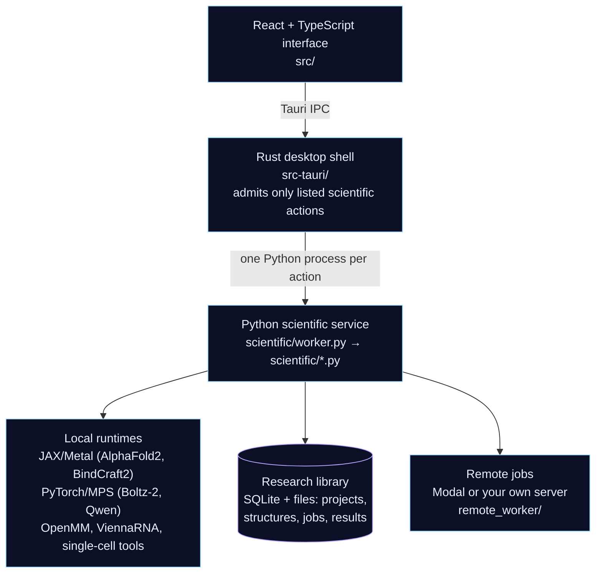

<details>
<summary><b>Plain-text diagram</b></summary>

```
React + TypeScript interface (src/)
        │  Tauri IPC
Rust desktop shell (src-tauri/)      admits only listed scientific actions
        │  one Python process per action
Python scientific service (scientific/worker.py → scientific/*.py)
        │
        ├─ local runtimes   JAX/Metal (AlphaFold2, BindCraft2), PyTorch/MPS
        │                   (Boltz-2, Qwen), OpenMM, ViennaRNA, single-cell tools
        ├─ research library SQLite + files: projects, structures, jobs, results
        └─ remote jobs      Modal or your own server (remote_worker/)
```

</details>

<details>
<summary><b>Components in detail</b></summary>

- **Interface.** React 19 and TypeScript, Mol* for molecules, WebGL2 for cell
  volumes.
- **Desktop shell.** Tauri 2 in Rust. It owns file dialogs, starts the Python
  service, and refuses any scientific action not on its allow list.
- **Scientific service.** One Python module per lab. Each action runs in a fresh
  process, so nothing depends on state held in memory.
- **Runtimes.** A separate Python environment per engine, so their dependencies
  never collide. The packaged app carries its own copies.
- **Research library.** A folder with SQLite and files. Each saved result keeps
  its inputs, model versions and a checksum, so it reopens exactly.
- **Models and data.** Large files live outside the repository, pinned by
  revision and SHA-256. See [ASSETS.md](ASSETS.md).

</details>

<p align="right"><sub><a href="#top">Back to top ↑</a></sub></p>

<p align="center"></p>

## Getting started

### Download the app

The built app is on the
[releases page](https://github.com/sparklesviii23/fold-studio/releases/latest).
Download both `.part` files and follow the install steps there. It includes the
Python runtimes and the AlphaFold2 weights, so binder design works immediately.

### Build from source

Requires macOS on Apple Silicon, Python 3.12, pnpm and Rust.

```sh
brew install python@3.12 pnpm
curl https://sh.rustup.rs -sSf | sh
git clone https://github.com/sparklesviii23/fold-studio.git
cd fold-studio
bash scripts/setup.sh            # dependencies + Python runtimes
bash scripts/setup.sh --models   # pinned model weights, ~18 GB, checksum-verified
pnpm desktop                     # run in development
pnpm bundle                      # or build the .app
```

`setup.sh` puts runtimes and models in the folder containing the clone; set
`FOLD_WORKSPACE` to choose another. Datasets for Virtual Cell and Oncology
download inside the app the first time you open those labs.

To use cloud models, open **Settings → Compute servers** and add a Modal API
token. Jobs are billed to your account, and the app asks before each run.

### Tests

<details>
<summary><b>Run the test suites</b></summary>

```sh
pnpm test                                   # interface
node node_modules/typescript/bin/tsc -b     # types
../runtimes/gbcell/bin/python -B -m unittest discover -s tests
```

</details>

<p align="right"><sub><a href="#top">Back to top ↑</a></sub></p>

<p align="center"></p>

## Repository layout

<details>
<summary><b>Top-level folders</b></summary>

| Path | Contents |
| --- | --- |
| `src/` | React interface, Mol* viewer, cell rendering, lab workspaces |
| `src-tauri/` | Rust shell, native capabilities, action allow list, packaging |
| `scientific/` | Python service: one module per lab, plus model and data adapters |
| `remote_worker/` | Code that runs inside cloud containers |
| `docs/` | Per-lab documentation, validation reports and data provenance |
| `fixtures/`, `tests/`, `scripts/` | Reference data, tests, build and setup tools |

</details>

<p align="center"></p>

## Current limitations

- **Hardware.** Apple Silicon only. The tested machine is an M4 Pro with 24 GB
  of unified memory on macOS 26.4.1.
- **Not notarised.** The release is signed locally, so macOS needs
  `xattr -dr com.apple.quarantine` before first launch.
- **ChimeraX.** Some tools need a separately installed UCSF ChimeraX 1.12.
  Feature parity with it is not complete.
- **Fab is deferred** and not available in this build.
- **Trained checkpoints** for Qwen RNA and RNA design are not public; features
  that need them report the checkpoint as missing.
- **Scientific scope.** Prediction confidence and computed geometry do not
  establish binding or biological activity. Nothing here is clinical advice.

<p align="center"></p>

## Technology and credits

<p align="center">
  
</p>

<details>
<summary><b>Engines, libraries and data sources</b></summary>

| Component | Built with |
| --- | --- |
| Desktop app | [Tauri 2](https://github.com/tauri-apps/tauri), Rust |
| Interface | [React 19](https://github.com/facebook/react), TypeScript, [Lucide](https://github.com/lucide-icons/lucide), Vite |
| Molecular graphics | [Mol*](https://github.com/molstar/molstar) |
| Structure prediction | [AlphaFold2](https://github.com/google-deepmind/alphafold), [Boltz](https://github.com/jwohlwend/boltz), [BindCraft2](https://github.com/PacesaLab/BindCraft2), [RhoFold+](https://github.com/ml4bio/RhoFold), [ESMFold2](https://github.com/evolutionaryscale/esm) |
| Genome and cell models | [Evo 2](https://github.com/ArcInstitute/evo2), [Borzoi](https://github.com/calico/borzoi), [Cell2Sentence](https://huggingface.co/vandijklab), [CellFlux](https://github.com/yuhui-zh15/CellFlux) |
| Simulation | [OpenMM](https://openmm.org/), [ViennaRNA](https://www.tbi.univie.ac.at/RNA/), [PhysiCell](https://github.com/MathCancer/PhysiCell), [HemoCell](https://github.com/UvaCsl/HemoCell), SciPy |
| Reference data | [UniProt](https://www.uniprot.org/), [AlphaFold DB](https://alphafold.ebi.ac.uk/), [RCSB PDB](https://www.rcsb.org/), [DepMap](https://depmap.org/), [OpenOrganelle](https://openorganelle.janelia.org/), [CELLxGENE](https://cellxgene.cziscience.com/) |
| Scientific adapter | Original FOLD Python code talking to an installed [UCSF ChimeraX](https://www.rbvi.ucsf.edu/chimerax/) |

</details>

FOLD STUDIO's interface, project handling, service bridge and workflow code are
application-specific code written with AI assistance. The upstream engines above
provide their own implementations; this project does not reimplement or retrain
them.

<p align="center"></p>

## Licence

App code is MIT ([LICENSE](LICENSE)). Third-party libraries, models and datasets
keep their own terms, including research-only and non-commercial ones; see
[THIRD_PARTY_NOTICES.md](THIRD_PARTY_NOTICES.md) and [ASSETS.md](ASSETS.md).
ChimeraX is not included, and a licence to run it does not allow redistributing
it.

---

<p align="center">
  <br>
  <sub>Built on Apple Silicon · <a href="#top">Back to top ↑</a></sub>
</p>
