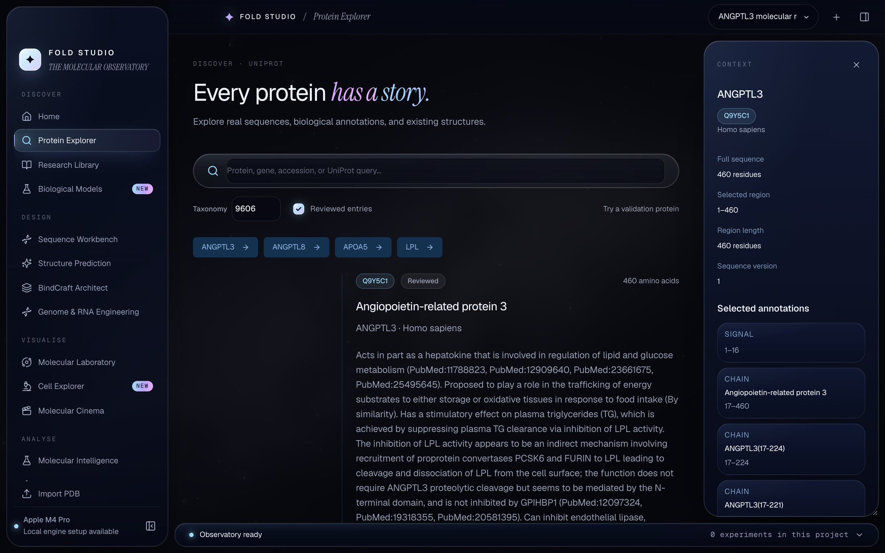
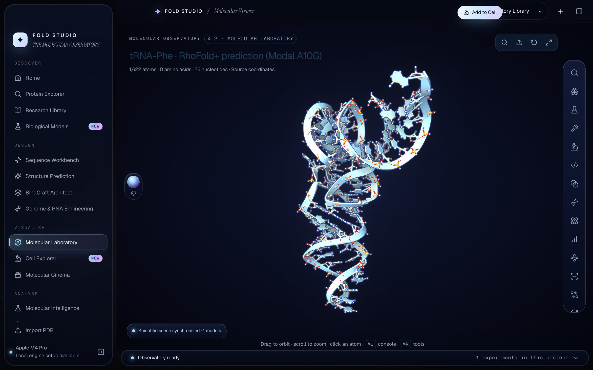
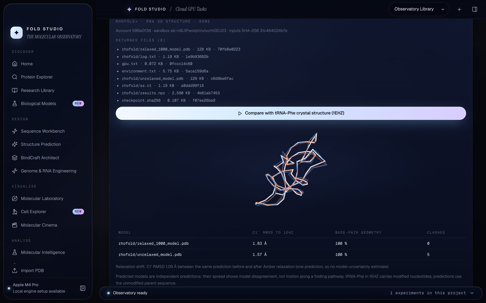
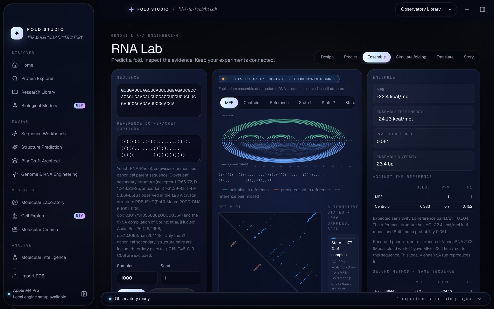
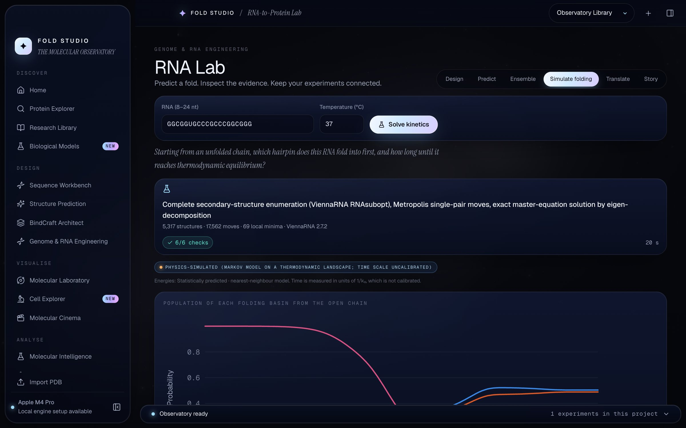
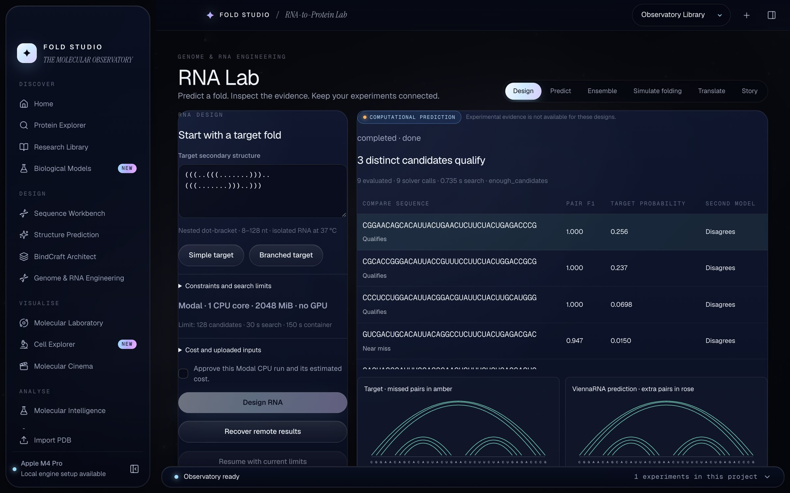
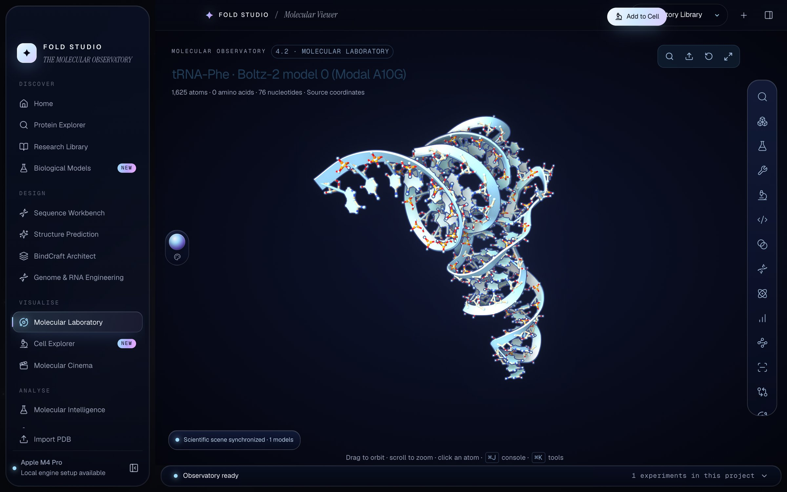
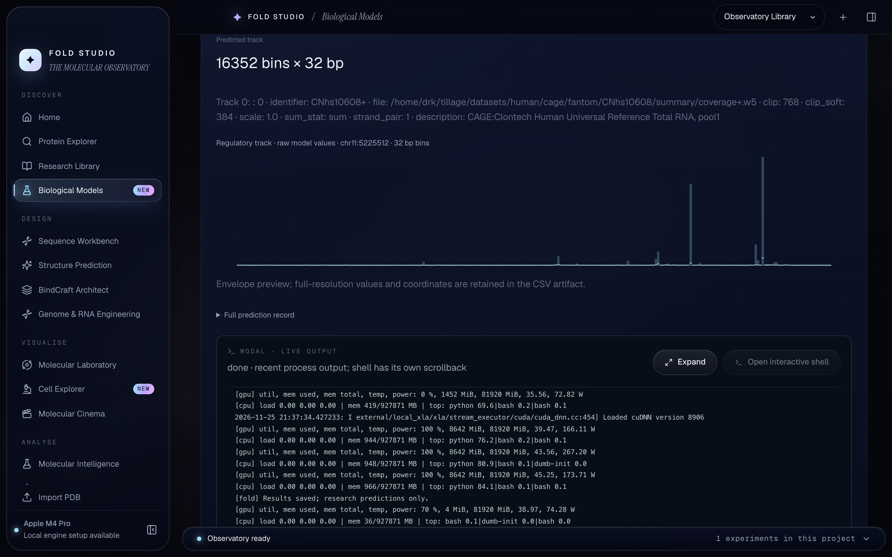
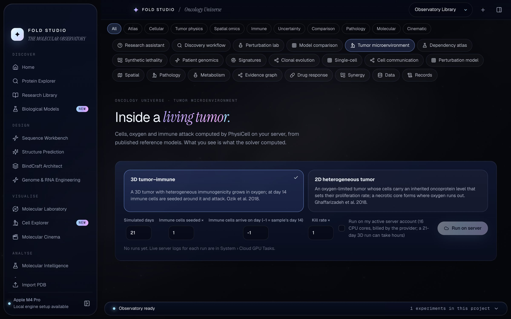
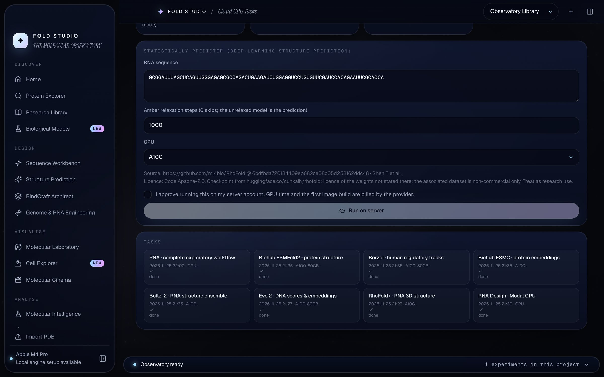

<a id="top"></a>

<p align="center">
  
</p>

<p align="center">
  <b>A student project: protein structure, protein and RNA design, RNA folding, simulated cells and cancer data in one app.</b><br>
  <sub>Experimental. Many parts work but lots of work left to do.</sub>
</p>

<p align="center">
  
  
  
  
  
  
  
</p>

<p align="center">
  <a href="#getting-started"></a>
</p>

<p align="center">
  <a href="#about">About</a>
  &nbsp;·&nbsp; <a href="#status">Status</a>
  &nbsp;·&nbsp; <a href="#gallery">Gallery</a>
  &nbsp;·&nbsp; <a href="#whats-in-here">What's in here</a>
  &nbsp;·&nbsp; <a href="#how-it-is-built">How it is built</a>
  &nbsp;·&nbsp; <a href="#getting-started">Getting started</a>
  &nbsp;·&nbsp; <a href="#credits">Credits</a>
  &nbsp;·&nbsp; <a href="#licence">Licence</a>
</p>

<br>

<p align="center">
  
</p>

> [!IMPORTANT]
> This is a student project and an open-source experiment. Outputs are computational predictions. Do not use them for medical, clinical or safety decisions.

<p align="right"><sub><a href="#top">Back to top ↑</a></sub></p>

## About

Fold is a macOS desktop application for exploring computational biology and 
integrating scientific tools within a unified research environment. 
The application uses Tauri (Rust), React and TypeScript, with Python for 
scientific computation. Lightweight workloads execute natively on macOS, 
while computationally intensive models can run through a [Modal](https://modal.com) 
account (they give 30$/month for free credits to use on any GPU)

Each saved result retains its inputs, model versions, execution logs 
and checksum to support reproducibility and computational provenance. 
Evidence is explicitly classified as measured, predicted, simulated or illustrative.

The project is independently developed and maintained by a single contributor, 
with AI-assisted software development and manual review and testing. 
Commit messages and documentation in `docs/` record development progress, 
implementation details and internal validation results.

## Status

Review the following section for the current implementation status
and scientific limitations.

**Operational.** The structure viewer, project
library, molecular analysis tools, RNA folding calculations and
native binder-design pipeline have been tested on M4 Pro 24gb, they
are functional.

**Partially operational.** Cloud-based model execution (Boltz-2,
RhoFold+, ESMFold2, Evo 2, Borzoi and RNA design) has been tested
through Modal, I was not able to port/optimise them on mac yet due 
to insufficient RAM memory. Execution depends on account configuration, resource
availability and computational budget. Cost estimates are not real it's an error. 
Virtual cell and mechanistic simulation environments
are research prototypes based on public datasets.

**Experimental components.** The adapted Qwen RNA predictor
currently performs below classical computational baselines.
The experimental RNA inverse-design model has not demonstrated
superior performance relative to the simpler reference solver.
The current RNA design benchmark comprises 27 synthetic targets
and two random seeds, which is insufficient to establish
generalizable predictive performance. I am continuing to train the model.

**Development roadmap.** The internal implementation audit,
[`docs/FOLD_STUDIO_ULTIMATE_COMPLETION_AUDIT.md`](docs/FOLD_STUDIO_ULTIMATE_COMPLETION_AUDIT.md),
classifies all planned sections as "Not established." These include
molecular docking, virtual screening, ADMET prediction, extended
molecular dynamics, free-energy calculations, quantum chemistry,
antibody and enzyme engineering, base editing and prime editing.
Existing scaffolding and preliminary implementations do not
constitute operational scientific tools.

**Scientific validation.** All current tests, benchmarks and
verification procedures have been conducted internally during
development. No independent laboratory, external reviewer or
third-party benchmarking group has validated the results.

<p align="right"><sub><a href="#top">Back to top ↑</a></sub></p>

## Gallery

These pictures show the app as it is now. Local experiments ran on an M4 Pro.
Cloud experiments ran on Modal. Each picture shows one run. Most runs were on
small inputs.

### Proteins and structure

<table>
<tr>
<td width="50%"><br><sub><b>Molecular Viewer.</b> ANGPTL3 from AlphaFold DB, drawn with Mol*.</sub></td>
<td width="50%"><br><sub><b>ESMFold2 on Modal (A100).</b> Green fluorescent protein predicted from sequence. The prediction shows the barrel fold.</sub></td>
</tr>
<tr>
<td width="50%"><br><sub><b>BindCraft Architect.</b> A binder-design campaign run locally on Apple Silicon.</sub></td>
<td width="50%"><br><sub><b>Protein Explorer.</b> UniProt sequences, annotations and known structures.</sub></td>
</tr>
</table>

### Cells

<table>
<tr>
<td width="50%"><br><sub><b>Cell Explorer.</b> A whole HeLa cell imaged by FIB-SEM (OpenOrganelle <code>jrc_hela-2</code>).</sub></td>
<td width="50%"><br><sub><b>A simulation in the cell.</b> 120 copies of a protein released into the cytoplasm and moved by Brownian dynamics.</sub></td>
</tr>
<tr>
<td width="50%"><br><sub><b>Light pulse.</b> Green-light pulses driving a CcaS/CcaR reporter in <i>E. coli</i>, in a model fitted by me.</sub></td>
<td width="50%"><br><sub><b>Virtual Cell (prototype).</b> A K-562 model built from public Perturb-seq and DepMap data, with KLF1 switched on.</sub></td>
</tr>
</table>

### RNA

<table>
<tr>
<td width="50%"><br><sub><b>RhoFold+ on Modal (A10G).</b> Yeast tRNA-Phe predicted from sequence.</sub></td>
<td width="50%"><br><sub><b>Compared with a crystal structure.</b> 1.83 Å C1′ RMSD to 1EHZ for this one prediction.</sub></td>
</tr>
<tr>
<td width="50%"><br><sub><b>Folding ensemble.</b> 1,000 ViennaRNA samples of tRNA-Phe, grouped into states with a base-pair probability plot.</sub></td>
<td width="50%"><br><sub><b>Folding kinetics.</b> All secondary structures enumerated for a small case and the master equation solved exactly.</sub></td>
</tr>
<tr>
<td width="50%"><br><sub><b>Inverse design on Modal CPU.</b> Sequences that fold into a branched target. A second model checks each one.</sub></td>
<td width="50%"><br><sub><b>Boltz-2 on Modal (A10G).</b> Five independent diffusion samples of the same tRNA.</sub></td>
</tr>
</table>

### Genomes, cancer and mechanisms

<table>
<tr>
<td width="50%"><br><sub><b>Evo 2 on Modal (A100).</b> Likelihood of the normal HBB sequence against the sickle-cell variant.</sub></td>
<td width="50%"><br><sub><b>Borzoi on Modal (A100).</b> A predicted CAGE track across a 524 kb window at the HBB locus.</sub></td>
</tr>
<tr>
<td width="50%"><br><sub><b>Oncology data.</b> DepMap CRISPR knockout scores across 1,178 cancer cell lines, for KRAS.</sub></td>
<td width="50%"><br><sub><b>Tumour microenvironment.</b> PhysiCell agent-based tumour–immune models, run on a connected server.</sub></td>
</tr>
<tr>
<td width="50%"><br><sub><b>Mechanistic Biology Lab.</b> The Kholodenko 2000 MAPK cascade, integrated with SciPy.</sub></td>
<td width="50%"><br><sub><b>Multiscale experiments.</b> One-way coupling from ribosome traffic on an mRNA to protein levels.</sub></td>
</tr>
</table>

### Compute

<table>
<tr>
<td width="50%"><br><sub><b>Cloud GPU Tasks.</b> Ready-made recipes that run in containers on a private Modal account.</sub></td>
<td width="50%"><br><sub><b>Local Compute.</b> The tasks this Mac can run, and which model files are present and verified.</sub></td>
</tr>
</table>

<p align="right"><sub><a href="#top">Back to top ↑</a></sub></p>

## What's in here

The code is organised by lab. Each lab has a document in [`docs/`](docs/) that
says what the code does, what it was tested on, and what is missing. Treat those
documents as my notes.

<details open>
<summary><b>🧬 Proteins</b></summary>

| Feature | Status |
| --- | --- |
| **Structure viewer and library** | Works for PDB and mmCIF files. Stores projects and notes locally. |
| **BindCraft2-style binder design** | Vendored upstream pipeline, run locally. |
| **Boltz-2 prediction** | Runs locally on PyTorch/MPS or on Modal. |
| [**Molecular Intelligence**](docs/MOLECULAR_INTELLIGENCE_4_3.md) | Contacts, clashes, buried surface area and interface reports. |
| [**Ligand preparation**](docs/LIGAND_PREPARATION.md) | SMILES → 3D conformers with RDKit, exported as SDF. |
| [**Dynamics**](docs/DYNAMICS_PILOTS.md) | Short OpenMM runs on saved proteins. |
| **Molecular Cinema** | Rendered movies of designed complexes. |

</details>

<details>
<summary><b>🌀 RNA</b></summary>

| Feature | Status |
| --- | --- |
| [**RNA Design**](docs/RNA_DESIGN.md) | Finds sequences for a dot-bracket target. Works well on small targets. |
| [**Folding and kinetics**](docs/RNA_TO_PROTEIN_LAB.md) | Ensembles, [exact kinetics](docs/RNA_FOLDING_KINETICS.md) for small cases, and translation. |
| **3D prediction** | RhoFold+ and Boltz-2 on Modal, with a comparison against crystal structures. |
| [**Qwen RNA**](docs/QWEN_RNA_ENGINE.md) | Experimental predictor. Under development for improvements. |
| [**EditCraft**](docs/EDITCRAFT_IMPLEMENTATION.md) | Genome and RNA engineering experiments. |

</details>

<details>
<summary><b>🔬 Cells</b></summary>

| Feature | Status |
| --- | --- |
| [**Virtual Cell**](docs/VIRTUAL_CELL.md) | K-562, Hep G2 and Tahoe-100M prototypes for perturbation and readout. Per-feature status in [VIRTUAL_CELL_CAPABILITIES.md](docs/VIRTUAL_CELL_CAPABILITIES.md). |
| **Cell Explorer** | HeLa FIB-SEM viewer and an illustrative E. coli model. Brownian-dynamics experiments. |
| [**Mechanistic Biology Lab**](docs/MECHANISTIC_BIOLOGY_LAB.md) | A few published SBML kinetic models integrated with SciPy. |
| [**Multiscale experiments**](docs/MULTISCALE_KERNEL.md) | One-way coupling across scales, [spatial diffusion](docs/SPATIAL_SOLVER.md), and blood transport. |

</details>

<details>
<summary><b>📊 Oncology</b></summary>

| Feature | Status |
| --- | --- |
| [**Oncology data**](docs/ONCOLOGY_DATA_AND_ANALYSIS.md) | Reads public DepMap, GDSC and TCGA data. |
| [**Tumour microenvironment**](docs/ONCOLOGY_TUMOR_MICROENVIRONMENT.md) | PhysiCell simulations on a connected server. |

</details>

<details>
<summary><b>☁️ Compute</b></summary>

| Feature | Status |
| --- | --- |
| [**Cloud GPU Tasks**](docs/CLOUD_GPU_TASKS.md) | Recipes for several models on a Modal account. |
| **Compute servers** | Pick this Mac, a Modal account, or a saved SSH host. |
| [**Local worker**](docs/LOCAL_WORKER.md) | Background macOS service for bounded development tasks. |

</details>

The [engine registry](docs/ENGINE_REGISTRY.md) lists the status of each engine.

<p align="right"><sub><a href="#top">Back to top ↑</a></sub></p>

## How it is built

```
React + TypeScript interface (src/)
        │  Tauri IPC
Rust desktop shell (src-tauri/)      only allows listed scientific actions
        │  one Python process per action
Python scientific code (scientific/worker.py → scientific/*.py)
        │
        ├─ local runtimes   JAX/Metal (AlphaFold2, BindCraft2), PyTorch/MPS
        │                   (Boltz-2, Qwen), OpenMM, ViennaRNA
        ├─ research library SQLite + files: projects, structures, jobs, results
        └─ remote jobs      Modal (remote_worker/)
```

- **Interface.** React 19 and TypeScript. Mol* for molecules. WebGL2 for cell volumes.
- **Desktop shell.** Tauri 2 in Rust. Owns file dialogs and starts the Python service.
- **Scientific code.** One Python module per lab. Each action runs in a new process.
- **Runtimes.** Each engine has its own Python environment, so dependencies do not clash.
- **Research library.** A folder with SQLite and files. Each result keeps its inputs, model versions and a checksum.
- **Models and data.** Large files stay outside the repository. Each is pinned by revision and SHA-256. See [ASSETS.md](ASSETS.md).

<p align="right"><sub><a href="#top">Back to top ↑</a></sub></p>

## Getting started

There is no release I would call stable. To try it, build from source. You
need macOS on Apple Silicon, Python 3.12, pnpm and Rust.

```sh
brew install python@3.12 pnpm
curl https://sh.rustup.rs -sSf | sh
git clone https://github.com/sparklesviii23/fold.git
cd fold
bash scripts/setup.sh            # dependencies and Python environments
bash scripts/setup.sh --models   # model weights, about 18 GB, checksum-checked
pnpm desktop                     # run in development mode
```

`setup.sh` puts environments and models in the folder that contains the clone.
Set `FOLD_WORKSPACE` to use another folder. Some datasets download the first
time you open the lab that needs them.

For cloud models, add your own Modal API token under **Settings → Compute
servers**. The app asks before each run (I am using Modal because they offer
30$ credits for free /month, most of their GPUs run for 1$/hour)

### Tests

```sh
pnpm test                                   # interface tests
node node_modules/typescript/bin/tsc -b     # type check
../runtimes/gbcell/bin/python -B -m unittest discover -s tests
```


<p align="right"><sub><a href="#top">Back to top ↑</a></sub></p>

## Repository layout

| Path | Contents |
| --- | --- |
| `src/` | React interface, molecule viewer, cell rendering, lab screens |
| `src-tauri/` | Rust shell, action allow list, packaging |
| `scientific/` | Python scientific code, one module per lab |
| `remote_worker/` | Code that runs inside cloud containers |
| `vendor/` | Copies of third-party code, with their own licences |
| `docs/` | Per-lab notes, audits, data sources |
| `tests/`, `scripts/`, `fixtures/` | Tests, build tools, reference data |

## Credits

The app code is mine, AI assistance in building it. The engines it calls belong to
other people: AlphaFold2, BindCraft2, Boltz, RhoFold+, ESMFold2, Evo 2, Borzoi,
OpenMM, ViennaRNA, RDKit, Mol*, and others. Their
authors are credited in [THIRD_PARTY_NOTICES.md](THIRD_PARTY_NOTICES.md). Public
data comes from UniProt, AlphaFold DB, RCSB PDB, DepMap, GDSC, OpenOrganelle and
CELLxGENE, each under its own terms.

## Licence

App code: MIT ([LICENSE](LICENSE)). Third-party code, models and datasets keep
their own licences, some of them research-only or non-commercial. Read
[THIRD_PARTY_NOTICES.md](THIRD_PARTY_NOTICES.md) and [ASSETS.md](ASSETS.md)
before reuse. ChimeraX is not included.

<p align="right"><sub><a href="#top">Back to top ↑</a></sub></p>
